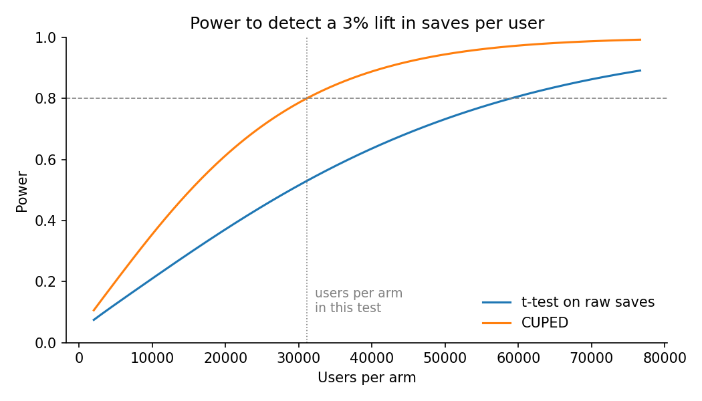
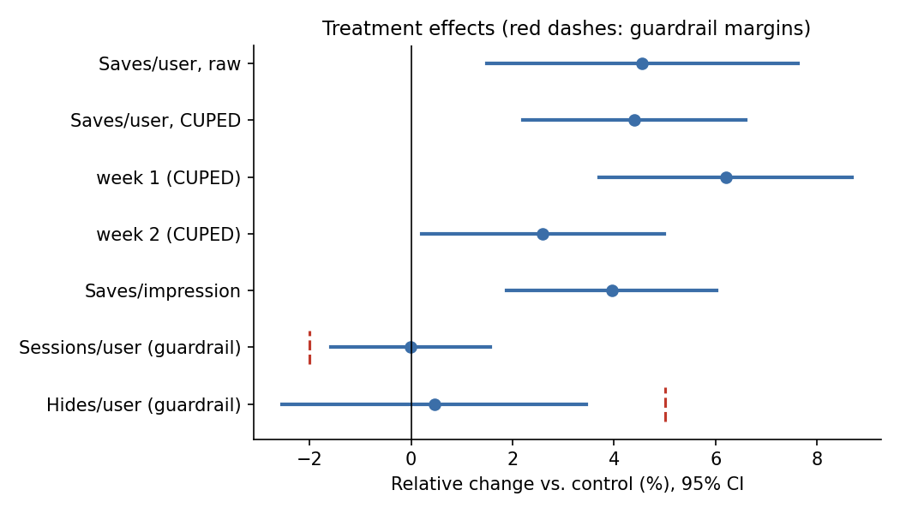

# Home feed experiment: analysis report

Generated by `run_experiment.py` from simulated data. True effects built into the simulation: 3% long-run lift in save rate, plus an extra 8% novelty lift on day 0 that halves every 2 days; hides up 2%; sessions unchanged.

## 1. Plan

Historical data (50,000 users, two consecutive 14-day periods): saves per user mean 5.26, SD 9.67, correlation with the previous period 0.69.

| Design | Users per arm for 80% power at a 3% MDE |
| --- | --- |
| t-test on raw saves | 58,957 |
| CUPED (pre-period saves as covariate) | 31,082 |

CUPED needs 47% fewer users. The test ran with 31,082 users per arm.

## 2. Sample ratio check

Control 30,863 vs. treatment 31,301; chi-square p = 0.08. Per-segment checks: app version 'current' p = 0.10, app version 'old' p = 0.53. All passed (an SRM is flagged at p < 0.001).

## 3. Results

| Metric | Lift | 95% CI | p-value |
| --- | --- | --- | --- |
| Saves per user (no CUPED) | +4.56% | +1.49% to +7.62% | 0.0029 |
| Saves per user (CUPED) | +4.40% | +2.19% to +6.60% | 6.5e-05 |
| Saves per user, week 1 (CUPED) | +6.20% | +3.71% to +8.69% | 5.1e-07 |
| Saves per user, week 2 (CUPED) | +2.60% | +0.20% to +4.99% | 0.031 |
| Saves per impression | +3.95% | +1.88% to +6.02% | 0.00014 |
| Sessions per user (CUPED) | -0.01% | -1.58% to +1.56% | 0.99 |
| Hides per user (CUPED) | +0.46% | -2.54% to +3.45% | 0.77 |

CUPED removed 50% of the variance in saves per user and narrowed the CI from 6.13 to 4.40 percentage points.

Novelty check: the week-1 lift (+6.2%) is larger than week 2 (+2.6%). Week 2 is the better estimate of the lasting effect (true values in the simulation: week 1 about 6.6%, week 2 about 3.3%), though its CI is wide.

## 4. Decision: SHIP

- Saves per user (CUPED) rose +4.4% (95% CI +2.2% to +6.6%) and all guardrails are within their margins.
- Expected lasting impact: about +2.6% saves per user (week-2 estimate), not the +4.4% full-period average, which includes novelty.

## 5. Same experiment with an assignment-logging bug

Here 20% of users are on an old app version that fails to log assignment for 15% of treated users. Those users still use the app; they are just missing from the experiment tables.

Overall, control has 30,863 users and treatment 30,321 (p = 0.028). That is not below the 0.001 threshold, so an overall-only check would miss the bug. The per-segment check catches it, and the decision is **DO NOT TRUST**.

| App version | Variant | Users | Share | Segment SRM p-value |
| --- | --- | --- | --- | --- |
| current | control | 24,700 | 49.6% | 9.9e-02 |
| current | treatment | 25,068 | 50.4% | 9.9e-02 |
| old | control | 6,163 | 54.0% | 1.6e-17 |
| old | treatment | 5,253 | 46.0% | 1.6e-17 |

The imbalance sits entirely in the old app version, which points straight at the bug.
Had we ignored SRM, the CUPED estimate would read +4.61% instead of +4.40%: the lost users save less than average, so dropping them inflates treatment.
